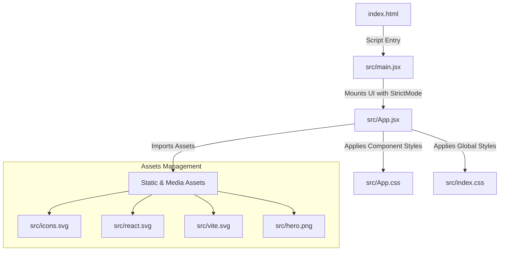

# 📝 Interactive React Form Project

An interactive, modern form application built using **React** and **Vite**. This application features a clean user interface, component-based modular structure, and custom styling.

---

## ✨ Features

- **⚡ Fast Build & HMR**: Powered by Vite for instant server start and lightning-fast Hot Module Replacement.
- **🎨 Modern Styling**: Clean, modular CSS structure (`App.css` and `index.css`) for consistent design across components.
- **🧩 Reusable UI Components**: Functional React components built with modern JSX syntax and ESLint compliance.
- **📱 Responsive Layout**: Fully responsive interface optimized for desktop, tablet, and mobile screens.

---

## 🏗️ Project Architecture & Flow



---

## 📁 Project Structure

```text
Form/
│
├── 📄 .gitignore          # Files and folders ignored by Git
├── 📄 App.css             # Component-level styling for App component
├── 📄 App.jsx             # Main React application logic and form component
├── 📄 eslint.config.js    # ESLint configuration and code quality rules
├── 📄 favicon.svg         # Site icon displayed in the browser tab
├── 📄 hero.png            # Visual banner asset
├── 📄 icons.svg           # Scalable vector graphics sprite
├── 📄 index.css           # Global baseline styles and CSS variables
├── 📄 index.html          # HTML entry point for Vite
├── 📄 main.jsx            # Application root entry point (DOM rendering)
├── 📄 package.json        # Project metadata, dependencies, and scripts
├── 📄 package-lock.json   # Dependency version lockfile
├── 📄 react.svg           # React logo asset
└── 📄 vite.config.js      # Vite build configuration
```

---

## 🚀 Getting Started

Follow these steps to run the project locally on your machine.

### Prerequisites

Ensure you have the following installed:
- [Node.js](https://nodejs.org/) (v16.0 or higher recommended)
- `npm` (comes bundled with Node.js)

### Installation

1. **Clone the repository:**
   ```bash
   git clone [https://github.com/Venkatesh-Web-dev01/Form.git](https://github.com/Venkatesh-Web-dev01/Form.git)
   cd Form
   ```

2. **Install dependencies:**
   ```bash
   npm install
   ```

3. **Start the local development server:**
   ```bash
   npm run dev
   ```

4. Open your browser and navigate to `http://localhost:5173`.

---

## 🛠️ Scripts & Commands

| Command | Description |
| :--- | :--- |
| `npm run dev` | Starts the local development server |
| `npm run build` | Bundles and builds the app for production |
| `npm run preview` | Previews the production build locally |
| `npm run lint` | Runs ESLint to check for syntax and code style errors |

---

## 🛠️ Tech Stack

- **Framework**: [React](https://react.dev/)
- **Build Tool**: [Vite](https://vitejs.dev/)
- **Styling**: CSS3
- **Linting**: ESLint

---

## 📄 License

This project is open-source and available under the [MIT License](LICENSE).
## 🧠 Logical Conditions & Form Validation Rules

The form component applies strict frontend state management and validation logic to ensure data integrity before submission:

### 1. Field Validation Logic
* **Required Fields:** Validates that mandatory inputs (e.g., Name, Email, Password) are non-empty and stripped of leading/trailing whitespaces.
* **Email Format:** Evaluates input against standard regular expressions:
  $$\text{Regex}: \texttt{/^[^\s@]+@[^\s@]+\.[^\s@]+$/}$$
* **Password Complexity:**
  * Minimum length: 8 characters.
  * Must contain at least 1 uppercase letter, 1 number, and 1 special character.
* **Real-time Feedback:** Input validation triggers on the `onChange` or `onBlur` event, updating error state objects dynamically without blocking typing.

### 2. Form Submission State Flow
## 🎨 Design Thinking & UI/UX Approach

The interactive form design follows a 5-stage human-centered Design Thinking framework aimed at maximizing user conversion and minimizing form fatigue:

### 1. Empathize (User Context)
* **User Pain Points:** Long, confusing form fields, unexpected submission errors, and slow page reloads.
* **Context:** Users expect instant visual confirmation when entering credentials or dynamic data.

### 2. Define (Core Problem)
> *"How might we create an intuitive, accessible, and fast interactive form that guides users seamlessly through input completion without friction?"*

### 3. Ideate (UX Solutions)
* **Micro-interactions:** Smooth focus outlines, real-time error text, and clear button state transitions.
* **Component Modularity:** Encapsulate form controls within React for easy scalability and maintenance.

### 4. Visual Design System & Palette

The visual design relies on a cohesive CSS variable system for consistent branding, high contrast, and accessible UI feedback:

| Role | Hex Code / Variable | Usage Context |
| :--- | :--- | :--- |
| **Primary Accent** | `#6366F1` (`--primary-color`) | CTA buttons, active state highlights, link colors |
| **Primary Hover** | `#4F46E5` (`--primary-hover`) | Button hover states and active focus rings |
| **Background Dark** | `#0F172A` (`--bg-main`) | Application surface and modal background |
| **Card / Container** | `#1E293B` (`--card-bg`) | Form container wrapper and elevated UI elements |
| **Text Primary** | `#F8FAFC` (`--text-main`) | Main form labels, titles, and input text |
| **Text Muted** | `#94A3B8` (`--text-muted`) | Placeholders, secondary labels, and helper text |
| **Success State** | `#22C55E` (`--color-success`) | Input checkmarks and successful submit banners |
| **Error / Alert** | `#EF4444` (`--color-error`) | In-line validation warnings and failed state borders |

### 5. Prototype & Test
* Tested responsiveness across viewport sizes (Mobile, Tablet, Desktop) using flex/grid CSS layouts in `App.css` and `index.css`.
