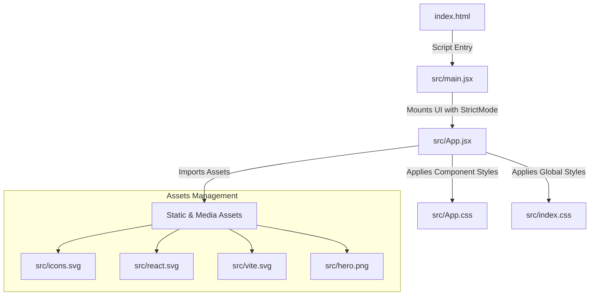

# 📝 Interactive React Form Project

An interactive, modern form application built using **React** and **Vite**. This application features a clean user interface, component-based modular structure, and custom styling.

---

## ✨ Features

- **⚡ Fast Build & HMR**: Powered by Vite for instant server start and lightning-fast Hot Module Replacement.
- **🎨 Modern Styling**: Clean, modular CSS structure (`App.css` and `index.css`) for consistent design across components.
- **🧩 Reusable UI Components**: Functional React components built with modern JSX syntax and ESLint compliance.
- **📱 Responsive Layout**: Fully responsive interface optimized for desktop, tablet, and mobile screens.

---

## 🏗️ Project Architecture & Flow



---

## 📁 Project Structure

```text
Form/
│
├── 📄 .gitignore          # Files and folders ignored by Git
├── 📄 App.css             # Component-level styling for App component
├── 📄 App.jsx             # Main React application logic and form component
├── 📄 eslint.config.js    # ESLint configuration and code quality rules
├── 📄 favicon.svg         # Site icon displayed in the browser tab
├── 📄 hero.png            # Visual banner asset
├── 📄 icons.svg           # Scalable vector graphics sprite
├── 📄 index.css           # Global baseline styles and CSS variables
├── 📄 index.html          # HTML entry point for Vite
├── 📄 main.jsx            # Application root entry point (DOM rendering)
├── 📄 package.json        # Project metadata, dependencies, and scripts
├── 📄 package-lock.json   # Dependency version lockfile
├── 📄 react.svg           # React logo asset
└── 📄 vite.config.js      # Vite build configuration
```

---

## 🚀 Getting Started

Follow these steps to run the project locally on your machine.

### Prerequisites

Ensure you have the following installed:
- [Node.js](https://nodejs.org/) (v16.0 or higher recommended)
- `npm` (comes bundled with Node.js)

### Installation

1. **Clone the repository:**
   ```bash
   git clone [https://github.com/Venkatesh-Web-dev01/Form.git](https://github.com/Venkatesh-Web-dev01/Form.git)
   cd Form
   ```

2. **Install dependencies:**
   ```bash
   npm install
   ```

3. **Start the local development server:**
   ```bash
   npm run dev
   ```

4. Open your browser and navigate to `http://localhost:5173`.

---

## 🛠️ Scripts & Commands

| Command | Description |
| :--- | :--- |
| `npm run dev` | Starts the local development server |
| `npm run build` | Bundles and builds the app for production |
| `npm run preview` | Previews the production build locally |
| `npm run lint` | Runs ESLint to check for syntax and code style errors |

---

## 🛠️ Tech Stack

- **Framework**: [React](https://react.dev/)
- **Build Tool**: [Vite](https://vitejs.dev/)
- **Styling**: CSS3
- **Linting**: ESLint

---

## 📄 License

This project is open-source and available under the [MIT License](LICENSE).
